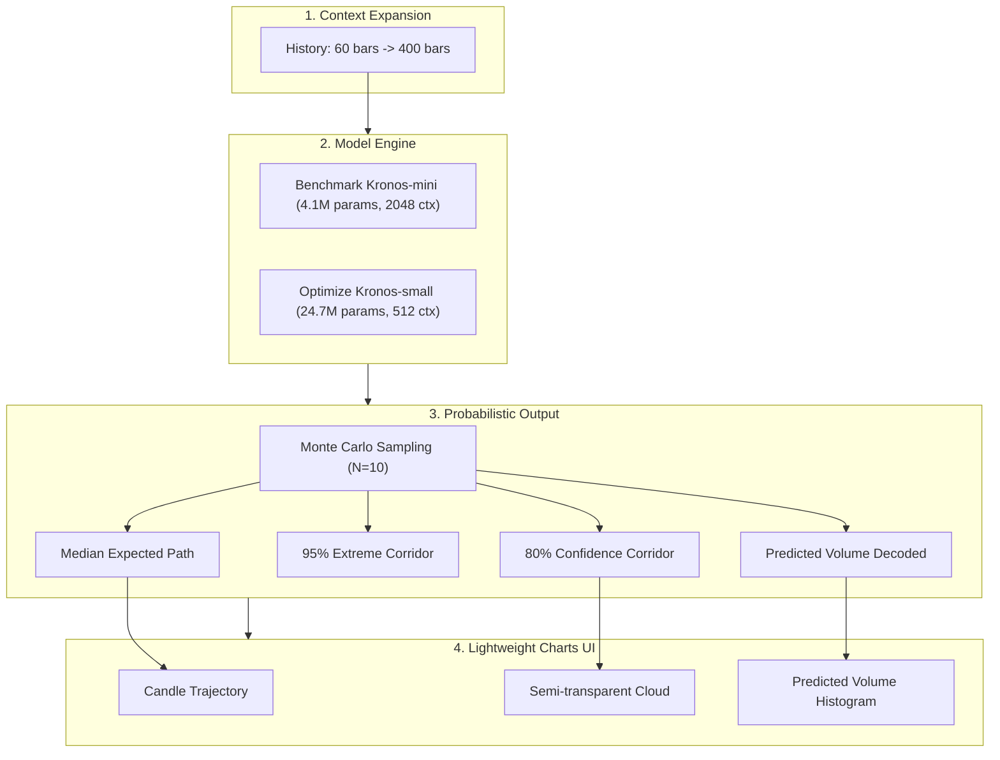
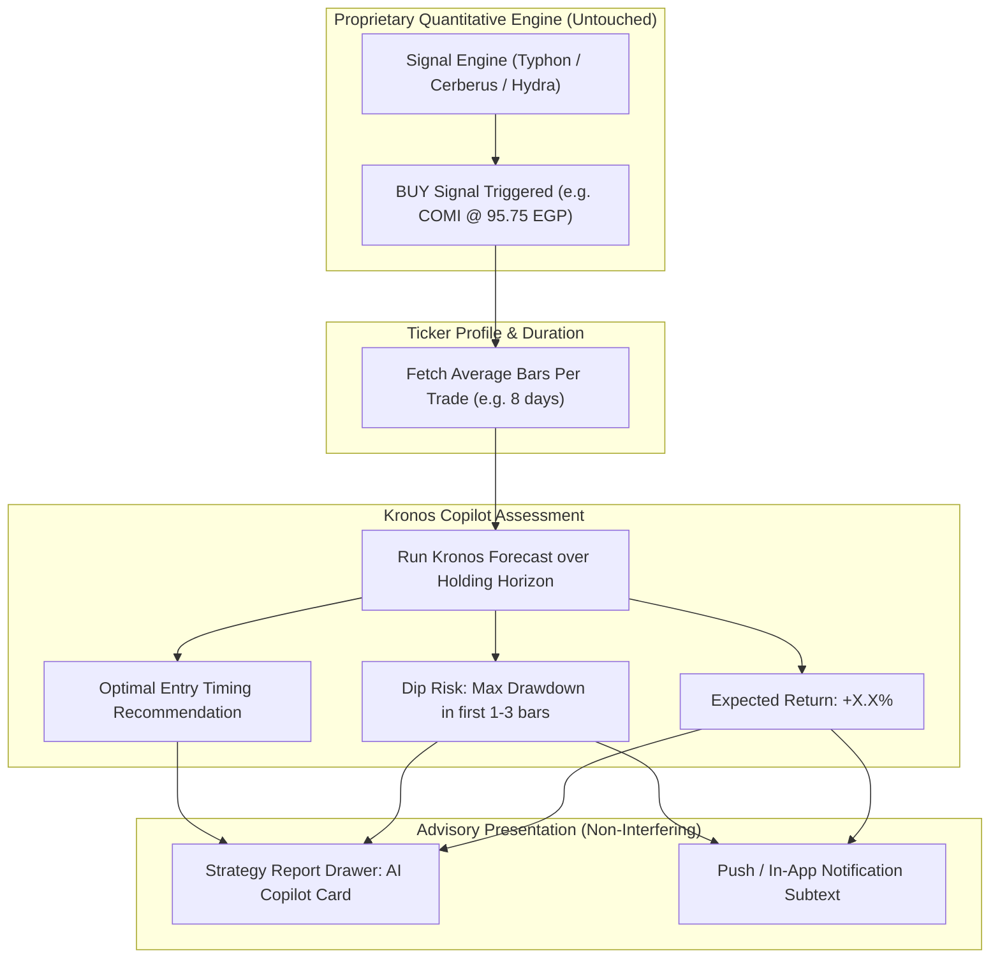

# Kronos Foundation Model Upgrade & Strategy Copilot Plan

> **For agentic workers:** REQUIRED SUB-SKILL: Use superpowers:subagent-driven-development (recommended) or superpowers:executing-plans to implement this plan task-by-task. Steps use checkbox (`- [ ]`) syntax for tracking.

**Goal:** Upgrade the Kronos financial foundation model integration to unlock full context, probabilistic Monte Carlo cones, and volume forecasting (Phase 1), then integrate Kronos as a non-interfering AI Advisory Copilot alongside proprietary trading signals to provide holding-horizon expected returns and entry dip timing advice (Phase 2).

**Architecture:** 
- **Phase 1 (Engine Upgrade):** Evaluate `Kronos-mini` (4.1M params, 2048-bar context, ~18MB ONNX) vs. `Kronos-small` (24.7M params, 512-bar context, ~117MB ONNX). Expand input context window from 60 to 400+ bars. Upgrade `KronosPredictor` to run Monte Carlo sampling ($N=10$) for median paths and 80%/95% confidence intervals, and decode predicted volume alongside price.
- **Phase 2 (Strategy Copilot):** Non-interfering advisory service that triggers when a proprietary strategy (Typhon, Cerberus, Hydra) generates a signal. Evaluates Kronos over the ticker's average holding period (bars per trade) to compute expected trade return $\hat{R}$, maximum projected adverse dip, and entry timing guidance without touching quantitative signal generation.

**Tech Stack:** Next.js 16, TypeScript, ONNX Runtime (`onnxruntime-node` / `onnxruntime-web` WASM), Lightweight Charts v4, Drizzle ORM, PostgreSQL.

**Spec / Baseline Documents:**
- [`src/tools/kronos/KronosPredictor.ts`](file:///c:/Users/abdelrahman.mamdouh_/Desktop/Overted%20Technologies/Ticknal/src/tools/kronos/KronosPredictor.ts)
- [`src/lib/handlers/strategy-handlers.ts`](file:///c:/Users/abdelrahman.mamdouh_/Desktop/Overted%20Technologies/Ticknal/src/lib/handlers/strategy-handlers.ts)
- [`src/components/platform/ChartWidget.tsx`](file:///c:/Users/abdelrahman.mamdouh_/Desktop/Overted%20Technologies/Ticknal/src/components/platform/ChartWidget.tsx)
- [`src/lib/notifications/pushNotifications.ts`](file:///c:/Users/abdelrahman.mamdouh_/Desktop/Overted%20Technologies/Ticknal/src/lib/notifications/pushNotifications.ts)
- Upstream: [`shiyu-coder/Kronos`](https://github.com/shiyu-coder/Kronos) (AAAI 2026)

---

## Global Constraints

- **Pure Black & Transparent Surfaces:** All new modals, drawers, and copilot badges must adhere strictly to `#000000` / `bg-transparent`, hairline borders (`border-white/10`), and sharp edges (`rounded-none` on sheets/drawers).
- **No Monospace Fonts:** Typography must strictly use `font-sans` with `tabular-nums` for numeric percentages and prices. No `font-mono`.
- **Zero Signal Tampering:** Kronos outputs are strictly advisory metadata. They must NEVER suppress, delay, filter, or modify BUY/SELL execution signals produced by quantitative models.
- **Strict Verification:** Every code task must pass `npx tsc --noEmit` and `npm run build` with exit code 0 before task completion.

---

## Review Focus

1. **Serverless Execution Budget:** Running Monte Carlo sampling ($N=10$) in WASM must not exceed Vercel route timeouts. If $N=10$ takes $>15\text{s}$ on `Kronos-small`, `Kronos-mini` or pre-computed background dispatch must be used.
2. **Zero Signal Regression:** Existing push notifications, in-app badges, and backtest metrics must match quantitative ground truth without regression.
3. **Price Continuity:** The boundary between the last historical close and the first predicted candle must be seamless without distorting volatility or scale.
4. **Trading Calendar Integrity:** Prediction steps must respect EGX Sunday–Thursday trading days and official holidays.
5. **Mobile Responsiveness:** Confidence cone overlays and copilot timing cards must render cleanly on mobile viewports without crowding chart controls.

---

## Phase 1: Model Upgrade & Full Capabilities



### Task 1.1: Context Window Expansion & Continuity Calibration

**Files:**
- Modify: `src/components/platform/ChartWidget.tsx`
- Modify: `src/lib/handlers/strategy-handlers.ts`
- Test: `_technical_support/kronos_tests/test_context_expansion.ts`

- [ ] **Step 1.1.1: Create test script to evaluate lookback lengths**
  Create `_technical_support/kronos_tests/test_context_expansion.ts` to benchmark prediction fidelity and latency across lookbacks of 60, 120, 250, and 400 bars on sample EGX tickers (COMI, ABUK).
- [ ] **Step 1.1.2: Update frontend payload in `ChartWidget.tsx`**
  Change `visibleData.slice(-60)` to `visibleData.slice(-400)` (clamped between 80 and 512 bars) to feed multi-quarter market structure into the transformer.
- [ ] **Step 1.1.3: Improve price continuity anchoring in `strategy-handlers.ts`**
  Replace crude static scalar multiplication (`scaleRatio = lastHistoricalClose / firstPredictedOpen`) with cumulative log-return projection:
  $\hat{P}_{t+k} = P_t \times \exp\left(\sum_{i=1}^k \hat{r}_i\right)$, preserving true relative volatility while ensuring exact boundary continuity.
- [ ] **Step 1.1.4: Run verification**
  Run `npx tsc --noEmit` and `npm run build` to verify clean compilation.

---

### Task 1.2: `Kronos-mini` Model Conversion & Latency Benchmarking

**Files:**
- Create: `_technical_support/kronos_tests/convert_kronos_mini.py`
- Create: `src/tools/kronos/models_mini/` (ONNX export of `NeoQuasar/Kronos-mini`)
- Modify: `src/tools/kronos/KronosPredictor.ts`

- [ ] **Step 1.2.1: Export `Kronos-mini` to ONNX**
  Download `NeoQuasar/Kronos-mini` and `NeoQuasar/Kronos-Tokenizer-2k` from Hugging Face and export:
  - `tokenizer_encode.onnx` (~4MB)
  - `model_decode_s1.onnx` (~12MB)
  - `model_decode_s2.onnx` (~2MB)
  - `tokenizer_decode.onnx` (~4MB)
- [ ] **Step 1.2.2: Benchmark `Kronos-mini` vs `Kronos-small` in Node/WASM**
  Compare execution time (ms per 10 steps), memory usage, and directional forecast accuracy on EGX 2025–2026 test bars.
- [ ] **Step 1.2.3: Support configurable model variant in `KronosPredictor.ts`**
  Add support for selecting between `small` and `mini` engines, defaulting to the model that achieves $<2\text{s}$ latency with equal or superior directional stability.
- [ ] **Step 1.2.4: Run verification**
  Confirm ONNX models load cleanly and `npm run build` exits 0.

---

### Task 1.3: Probabilistic Monte Carlo Sampling & Volume Decoding

**Files:**
- Modify: `src/tools/kronos/KronosPredictor.ts`
- Modify: `src/lib/handlers/strategy-handlers.ts`
- Modify: `src/components/platform/ChartWidget.tsx`
- Modify: `src/components/platform/chart/ChartPredictPopover.tsx`

- [ ] **Step 1.3.1: Implement Monte Carlo multi-path generation in `KronosPredictor.ts`**
  Add `sampleCount: number = 10` parameter. Run $N$ parallel token decoding paths through the autoregressive loop, computing:
  - `median`: 50th percentile OHLC
  - `upper80` / `lower80`: 10th and 90th percentile bounds
  - `upper95` / `lower95`: 5th and 95th percentile bounds
- [ ] **Step 1.3.2: Decode and return predicted volume**
  Extract index 4 (volume) from `allDecoded` in `KronosPredictor.ts`, denormalize with volume mean/std, and include `predictedVolume` in the API response.
- [ ] **Step 1.3.3: Expose Temperature Presets in `ChartPredictPopover.tsx`**
  Add a subtle selector in the Predict popover:
  - *"Conservative"* ($T=0.3$, tight corridor)
  - *"Balanced"* ($T=0.6$, default)
  - *"Volatile"* ($T=0.9$, wider exploration cone)
- [ ] **Step 1.3.4: Render Confidence Corridor & Predicted Volume on Lightweight Charts**
  Render median candles as solid predicted candlesticks, the 80% confidence interval as a shaded corridor, and predicted volume bars in the volume sub-pane.
- [ ] **Step 1.3.5: Run verification**
  Run `npx tsc --noEmit` and `npm run build` to verify clean build.

---

## Phase 2: Strategy Copilot & Advisory Layer



### Task 2.1: Kronos Copilot Advisory Service

**Files:**
- Create: `src/lib/strategies/ai-copilot/kronos-strategy-advisory.ts`
- Modify: `src/lib/strategy-analysis.ts`
- Test: `_technical_support/kronos_tests/test_strategy_advisory.ts`

- [ ] **Step 2.1.1: Define Copilot Advisory Data Contract**
  Define `KronosStrategyAdvisory` interface:
  ```ts
  export interface KronosStrategyAdvisory {
    tickerSymbol: string;
    strategyId: string;
    signalDate: string;
    signalType: 'BUY' | 'SELL';
    holdingHorizonBars: number; // Ticker's historical avg trade duration
    expectedReturnPercent: number; // Expected return at horizon
    corridor80: { lower: number; upper: number };
    maxAdverseExcursionPercent: number; // Max predicted dip before continuation
    dipTimingBars: number; // In how many bars the lowest price is hit
    entryTimingVerdict: 'IMMEDIATE' | 'WAIT_FOR_DIP' | 'HIGH_VOLATILITY';
    entryRangeRecommended?: { min: number; max: number };
    concordance: 'HIGH' | 'NEUTRAL' | 'DIVERGENT';
    generatedAt: string;
  }
  ```
- [ ] **Step 2.1.2: Implement `evaluateKronosSignalAdvisory`**
  Given a ticker, recent price bars, and the champion strategy's average bars per trade (from `StrategyMetrics.avgTradeDurationBars`):
  1. Forecast forward for `avgTradeDurationBars` (clamped between 5 and 20 days).
  2. Compute expected return from entry price: $(\hat{P}_{\text{horizon}} - P_{\text{entry}}) / P_{\text{entry}}$.
  3. Scan the initial 1–4 bars for maximum dip ($\text{min}(\hat{P}_{1..4}) - P_{\text{entry}}$).
  4. If dip $> 1.5\%$ and recovery occurs within horizon, set verdict to `'WAIT_FOR_DIP'` with the projected discount entry price. If dip $< 0.8\%$, set verdict to `'IMMEDIATE'`.
- [ ] **Step 2.1.3: Create unit test**
  Verify evaluation returns deterministic, calibrated metrics without mutating signal state.
- [ ] **Step 2.1.4: Run verification**
  Run `npx tsc --noEmit` to verify type safety.

---

### Task 2.2: Strategy Report Drawer UI Integration

**Files:**
- Create: `src/components/platform/strategy/StrategyAiCopilotCard.tsx`
- Modify: `src/components/platform/strategy/StrategyReportDrawer.tsx`
- Modify: `src/lib/handlers/strategy-handlers.ts`

- [ ] **Step 2.2.1: Build `StrategyAiCopilotCard.tsx`**
  Design a sleek card adhering to visual standards:
  - Pitch black surface (`bg-black` or `bg-transparent`), hairline border `border-white/10`.
  - Header: AI Copilot badge with brand styling, showing expected trade return with tabular-nums (e.g. `+5.2% over 8 sessions`).
  - Timing pill:
    - If `IMMEDIATE`: Green accent badge *"Immediate Entry Favored"*.
    - If `WAIT_FOR_DIP`: Amber badge *"Projected Dip (-1.8%) Days 1–3 — Rebound Expected"*.
  - Confidence corridor spread (80% confidence interval).
  - Explicit disclaimer: *"Advisory only. Quantitative strategy rules take precedence."*
- [ ] **Step 2.2.2: Embed Copilot Card into `StrategyReportDrawer.tsx`**
  Render the card directly below the Champion Model header when an active or actionable signal is selected.
- [ ] **Step 2.2.3: Add "Overlay Forecast on Chart" toggle**
  When clicked, broadcast the forecasted corridor to `ChartWidget` to display the Kronos projection directly ahead of the signal date.
- [ ] **Step 2.2.4: Run verification**
  Verify no console warnings, hydration issues, or layout shifts on desktop and mobile.

---

### Task 2.3: Notification & Daily Cron Enrichment

**Files:**
- Modify: `src/lib/notifications/pushNotifications.ts`
- Modify: `src/lib/handlers/notifications-handlers.ts`
- Modify: `src/components/platform/NotificationsDrawer.tsx`

- [ ] **Step 2.3.1: Enrich `signal_notifications` schema & payload**
  Include optional `aiAdvisory` json metadata in dispatched notifications (expected return, dip risk, entry verdict).
- [ ] **Step 2.3.2: Format Notification Copy**
  In [`pushNotifications.ts`](file:///c:/Users/abdelrahman.mamdouh_/Desktop/Overted%20Technologies/Ticknal/src/lib/notifications/pushNotifications.ts), format the push body:
  - Base: `ABUK · Typhon BUY @ 95.75 EGP`
  - Advisory line: `AI Outlook: +4.8% over 8d holding horizon | Low dip risk` (or `Watch dip to 94.20 EGP first`).
- [ ] **Step 2.3.3: Update In-App Notification Card in `NotificationsDrawer.tsx`**
  Render the timing badge cleanly inside the notification row without cluttering mobile screens.
- [ ] **Step 2.3.4: Run verification**
  Run `npx tsc --noEmit` and `npm run build` to ensure 100% green compilation.

---

## Plan Deliverable Summary

| Phase | Milestone | Deliverable |
| :--- | :--- | :--- |
| **Phase 1** | **Model & Engine Upgrade** | 400-bar context window, `Kronos-mini` sub-second inference evaluation, Monte Carlo 80%/95% confidence corridor, decoded predicted volume on charts. |
| **Phase 2** | **Strategy AI Copilot** | Zero-interference advisory layer matching ticker average trade duration, expected holding return calculation, entry dip timing advisory, and Strategy Report Drawer UI card. |
